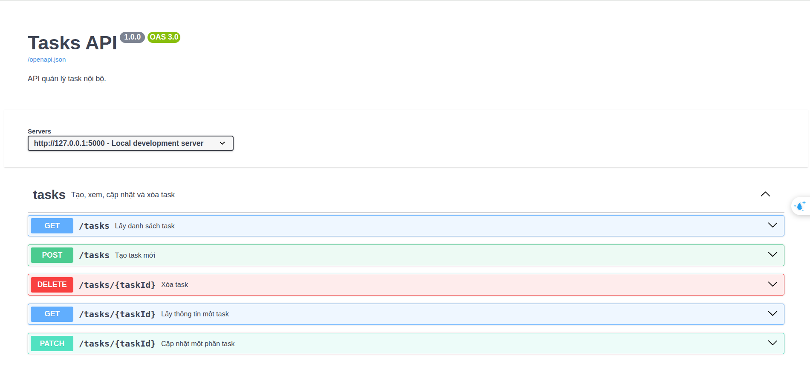
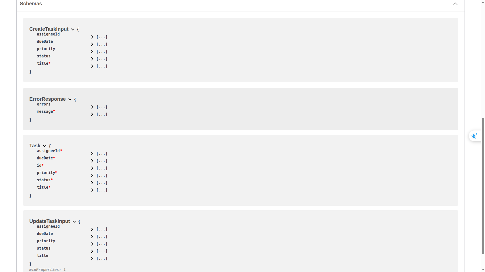

- python3 -m venv .venv
- source .venv/bin/activate
- pip install -r requirements.txt
- python week4/app.py
- Swagger UI: http://127.0.0.1:5000/docs
- OpenAPI Schema: http://127.0.0.1:5000/openapi.json

