# Lab: FLASK BOOKSTORE API
## Pagination, Keyset Cursor, Multi-Key Sorting & Filtering

Để triển khai đơn giản và gọn hơn, phần lab này được em triển khai bao gồm cả yêu cầu của Lab1, Lab2 và BTVN2. Sử dụng cơ sở dữ liệu SQLite và ORM SQLAlchemy, hỗ trợ đầy đủ 2 chiến lược phân trang: **Offset Pagination** và **Keyset/Cursor Pagination**, kết hợp filtering, multi-key sorting, sort-whitelist.

---

## 📂 LIÊN KẾT CÁC FILE QUAN TRỌNG
- **Application Entry Point:** [`Lab/lab1/app.py`](Lab/lab1/app.py)
- **Data Models (ORM):** [`Lab/lab1/models.py`](Lab/lab1/models.py)
- **Serialization & Validation Schemas:** [`Lab/lab1/schemas.py`](Lab/lab1/schemas.py)
- **API Routes:** [`Lab/lab1/routes.py`](Lab/lab1/routes.py)
- **Pagination & Keyset Engine:** [`Lab/lab1/pagination.py`](Lab/lab1/pagination.py)
- **Postman Collection:** [`Lab/lab1/postman/bookstore-pagination.postman_collection.json`](Lab/lab1/postman/bookstore-pagination.postman_collection.json) 
---

## 🛠️ SETUP & RUN

### 1. Cài đặt môi trường & thư viện
Mở terminal tại thư mục gốc của repository:
```bash
# Kích hoạt virtual environment (nếu đã có sẵn .venv)
source .venv/bin/activate

# Cài đặt các thư viện cần thiết
pip install -r requirements.txt
```

### 2. Khởi động Flask Server
Di chuyển vào thư mục bài tập `week5/Lab/lab1` và khởi chạy server:
```bash
cd week5/Lab/lab1
python app.py
```
- Server khởi chạy tại: `http://127.0.0.1:5000`
- Khi khởi động lần đầu, hệ thống sẽ tự động tạo database `bookstore.db` và nạp sẵn (seed) **4 thể loại** cùng **30 cuốn sách mẫu** (nhiều cuốn có cùng mức giá để kiểm thử tie-breaker).

### 3. Chạy Automated Tests (pytest)
Từ thư mục gốc của repository:
```bash
pytest -v
```
*(Toàn bộ 50 unit/integration test cases bao gồm offset, cursor keyset, filter, multi-key sort và CRUD sẽ tự động chạy trên SQLite in-memory độc lập).*

### 4. Chạy kiểm thử trên Postman
1. Mở Postman -> Chọn **Import** -> Chọn file collection:
   `postman/bookstore-pagination-sorting-filtering.postman_collection.json`
2. Cấu hình biến collection:
   - `baseUrl`: `http://127.0.0.1:5000`
3. Chạy lần lượt 16 request theo thứ tự dưới đây.

---

## 📋 CHI TIẾT CÁC TEST CASES TRONG POSTMAN COLLECTION

### 1. Offset Pagination - Defaults (limit=20, offset=0)
- **Request:** `GET {{baseUrl}}/api/v1/books`
- **Logic:** Lấy danh sách sách phân trang theo chiến lược Offset mặc định (`strategy=offset`). Khi client không truyền tham số, API tự động áp dụng `offset=0` và `limit=20`. Kết quả trả về dữ liệu 20 cuốn sách đầu tiên kèm metadata gồm `offset`, `limit`, tổng số bản ghi `total` và cờ `has_next: true`.

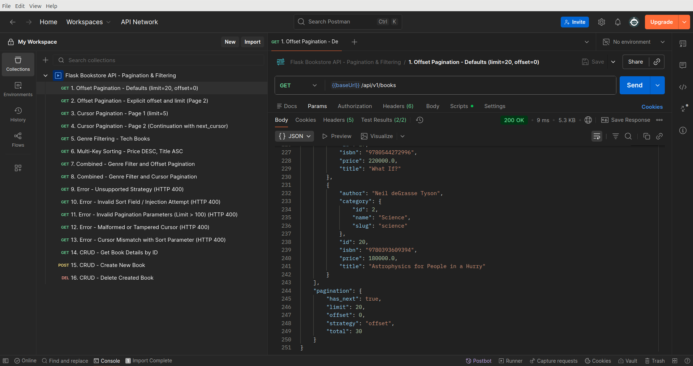

---

### 2. Offset Pagination - Explicit offset and limit (Page 2)
- **Request:** `GET {{baseUrl}}/api/v1/books?strategy=offset&offset=10&limit=10`
- **Logic:** Phân trang truyền rõ tham số `offset=10` và `limit=10` để lấy 10 bản ghi của trang thứ 2 (bắt đầu từ bản ghi thứ 11). Dữ liệu trang 2 hoàn toàn tách biệt, không bị trùng lặp với trang 1.

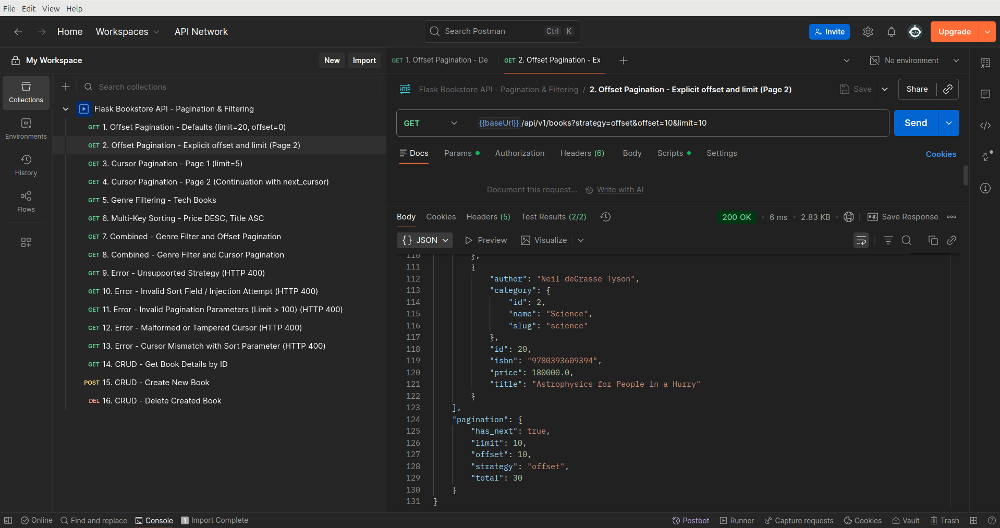

---

### 3. Cursor Pagination - Page 1 (limit=5)
- **Request:** `GET {{baseUrl}}/api/v1/books?strategy=cursor&limit=5`
- **Logic:** Lấy 5 bản ghi đầu tiên theo chiến lược Cursor. Database truy vấn `limit + 1` (6 bản ghi) để kiểm tra `has_more`. Điểm mấu chốt: `next_cursor` được sinh ra dưới dạng **Composite Cursor** lưu bộ giá trị kết hợp `(sort_value, id)` của cuốn sách cuối trang, trong đó `id` đóng vai trò **tie-breaker** duy nhất để chống bug mất/lặp bản ghi khi có các cuốn sách trùng giá trị sắp xếp (sort duplicate).

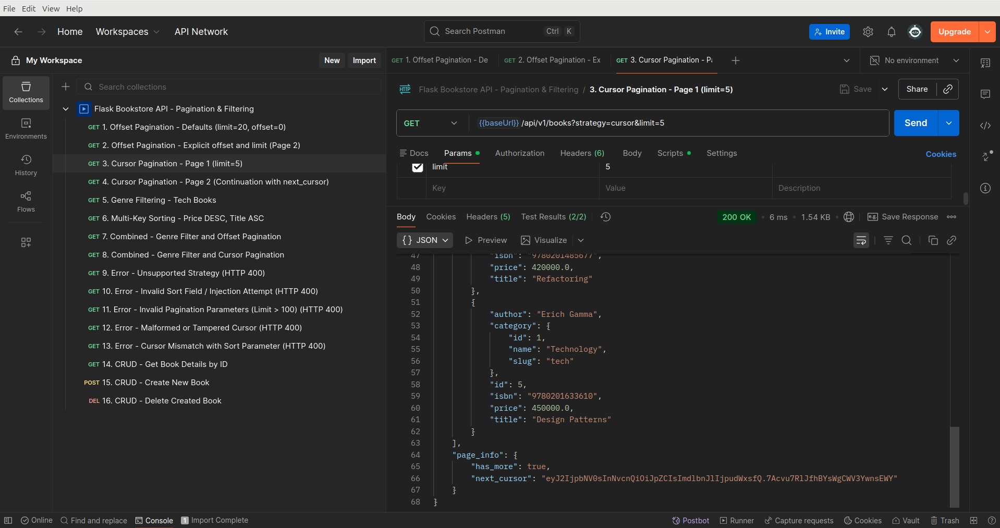

---

### 4. Cursor Pagination - Page 2 (Continuation with next_cursor)
- **Request:** `GET {{baseUrl}}/api/v1/books?strategy=cursor&limit=5&cursor={{nextCursor}}`
- **Logic:** Tiếp tục lấy 5 bản ghi trang sau bằng cách truyền `next_cursor`. Hệ thống giải mã composite cursor và áp dụng **Keyset formula** dạng:
  $$\text{WHERE } (\text{col}, \text{id}) < (\text{val}, \text{last\_id}) \quad \Leftrightarrow \quad \text{col} < \text{val} \;\lor\; (\text{col} = \text{val} \;\land\; \text{id} < \text{last\_id})$$
  Truy vấn trực tiếp qua index mệnh đề `WHERE` thay vì dùng `OFFSET`, giúp tốc độ truy vấn tối ưu và không bị trôi vị trí dữ liệu.

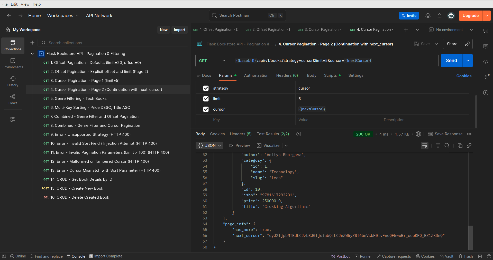

---

### 5. Genre Filtering - Tech Books
- **Request:** `GET {{baseUrl}}/api/v1/books?strategy=offset&genre=tech&limit=20`
- **Logic:** Lọc sách theo thể loại công nghệ (`genre=tech`). Hệ thống join với bảng `categories` và so khớp `Category.slug == 'tech'`. Toàn bộ sách trong mảng `data` trả về đều thuộc danh mục `tech`.


---

### 6. Multi-Key Sorting - Price DESC, Title ASC
- **Request:** `GET {{baseUrl}}/api/v1/books?strategy=offset&sort=-price,title&limit=10`
- **Logic:** Sắp xếp đa trường (`sort=-price,title`): giá giảm dần, nếu bằng giá thì xếp theo tiêu đề tăng dần. Tên trường công khai `price` được ánh xạ an toàn qua **Sort Whitelist** sang cột `Book.price_vnd` trong database và tự động tiêm `Book.id ASC` làm **tie-breaker** cuối cùng để bảo đảm thứ tự luôn tất định 100%.


---

### 7. Combined - Genre Filter and Offset Pagination
- **Request:** `GET {{baseUrl}}/api/v1/books?strategy=offset&genre=science&sort=-price&limit=3&offset=0`
- **Logic:** Kết hợp đồng thời: lọc thể loại khoa học (`genre=science`), sắp xếp giá giảm dần (`sort=-price`) và phân trang offset (`limit=3, offset=0`). Metadata `total=5` phản ánh chính xác tổng số sách khoa học sau khi lọc chứ không phải toàn bộ database.

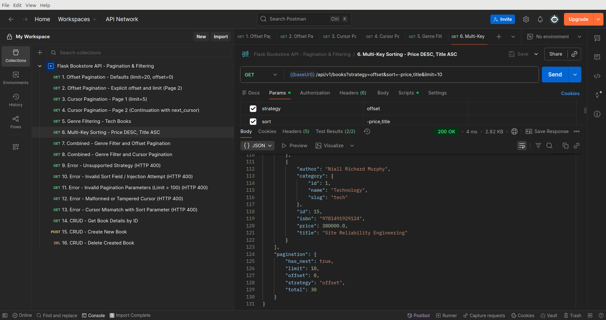

---

### 8. Combined - Genre Filter and Cursor Pagination
- **Request:** `GET {{baseUrl}}/api/v1/books?strategy=cursor&genre=fiction&limit=3`
- **Logic:** Kết hợp lọc thể loại (`genre=fiction`) với **Composite Cursor Keyset**. Token cursor sinh ra được đóng gói ràng buộc đồng thời cả filter state (`fiction`) và composite sort keys, đảm bảo việc duyệt dữ liệu qua cursor diễn ra liên tục, nhất quán và độc lập trên tập đã lọc.


---

### 9. Error - Unsupported Strategy (HTTP 400)
- **Request:** `GET {{baseUrl}}/api/v1/books?strategy=invalid_strategy`
- **Logic:** Kiểm thử xử lý lỗi khi client truyền tham số `strategy` không hợp lệ (ngoài `offset` và `cursor`). API chặn ngay tại tầng validation và trả về mã lỗi `HTTP 400 Bad Request` kèm thông báo chi tiết.

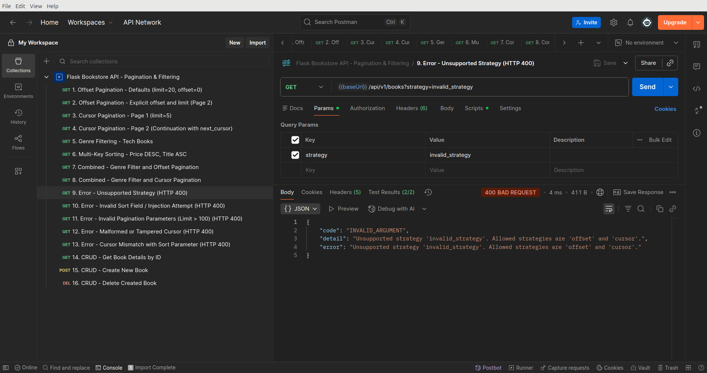

---

### 10. Error - Invalid Sort Field / Injection Attempt (HTTP 400)
- **Request:** `GET {{baseUrl}}/api/v1/books?sort=secret_password;DROP TABLE books;--`
- **Logic:** Kiểm tra cơ chế **Sort Whitelist** chống SQL Injection theo đúng Slide 23. Chỉ các cột hợp lệ (`id`, `price`, `title`, `author`, `isbn`) mới được chấp nhận; tuyệt đối không đưa raw tên cột từ client vào câu lệnh SQL. Bất kỳ chuỗi lạ hay mã injection nào đều bị từ chối ngay với `HTTP 400 Bad Request`.

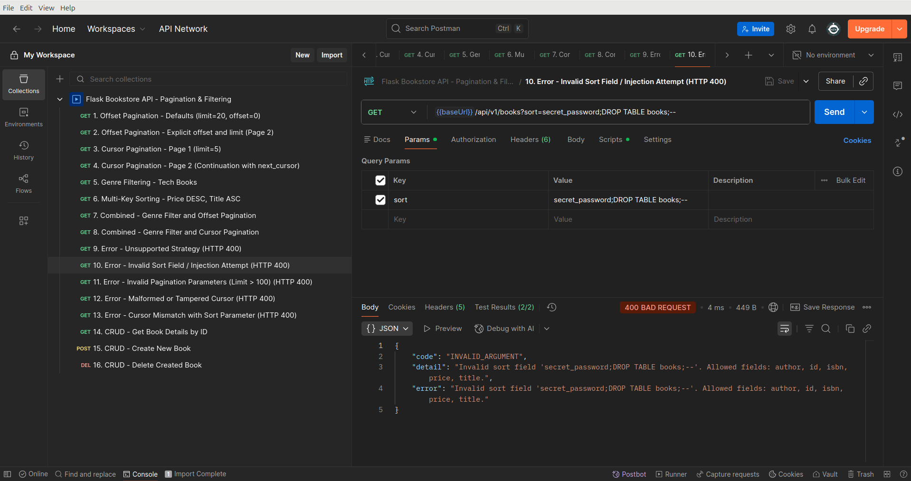

---

### 11. Error - Invalid Pagination Parameters (Limit > 100) (HTTP 400)
- **Request:** `GET {{baseUrl}}/api/v1/books?limit=999`
- **Logic:** Kiểm tra giới hạn phân trang. API quy định chặt chẽ `limit` chỉ được nhận giá trị từ 1 đến 100. Khi truyền `limit=999`, hệ thống trả về `HTTP 400 Bad Request` để ngăn chặn việc client yêu cầu tải quá tải dữ liệu vào bộ nhớ.

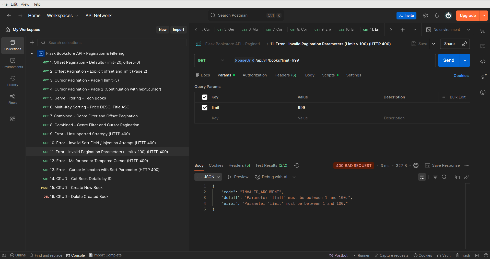

---

### 12. Error - Malformed or Tampered Cursor (HTTP 400)
- **Request:** `GET {{baseUrl}}/api/v1/books?strategy=cursor&cursor=malformed_tampered_token_xyz`
- **Logic:** Kiểm tra tính toàn vẹn và bảo mật của cursor. Nếu client tự ý chỉnh sửa token hoặc gửi chuỗi rác không đúng định dạng ký số HMAC, hệ thống giải mã thất bại và trả về `HTTP 400 Bad Request`.

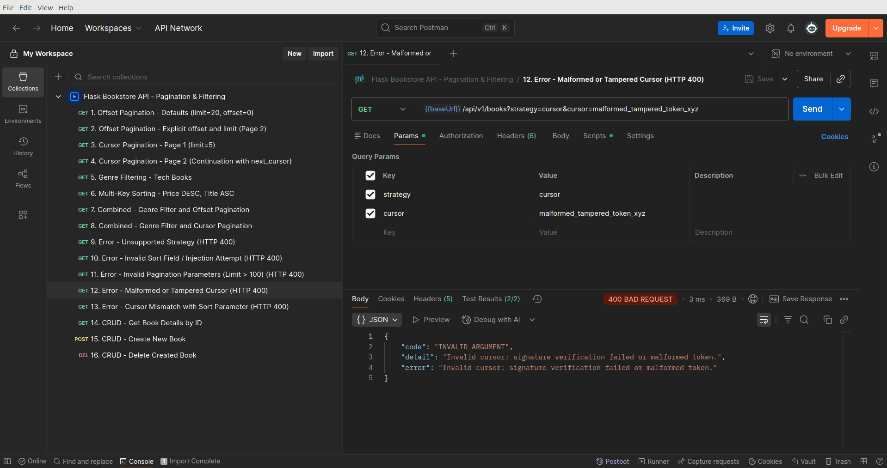

---

### 13. Error - Cursor Mismatch with Sort Parameter (HTTP 400)
- **Request:** `GET {{baseUrl}}/api/v1/books?strategy=cursor&sort=-price&cursor={{nextCursor}}`
- **Logic:** Kiểm chứng tính chất **Composite Context Binding** của cursor: Token cursor vốn đã mã hóa cấu hình composite sort ban đầu. Khi client dùng lại cursor này nhưng lại truyền `sort=-price` khác với lúc sinh cursor, server giải mã phát hiện mismatch và từ chối với `HTTP 400 Bad Request` để tránh việc seek sai lệch dữ liệu.

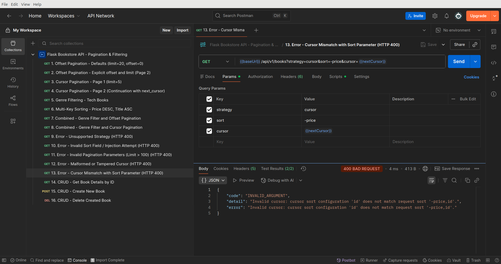

---

### 14. CRUD - Get Book Details by ID
- **Request:** `GET {{baseUrl}}/api/v1/books/1`
- **Logic:** Lấy thông tin chi tiết của một cuốn sách theo ID (`1`). Trả về `HTTP 200 OK` với đầy đủ thông tin: ID, tiêu đề, tác giả, mã ISBN, giá tiền và object lồng thể loại (`category`).

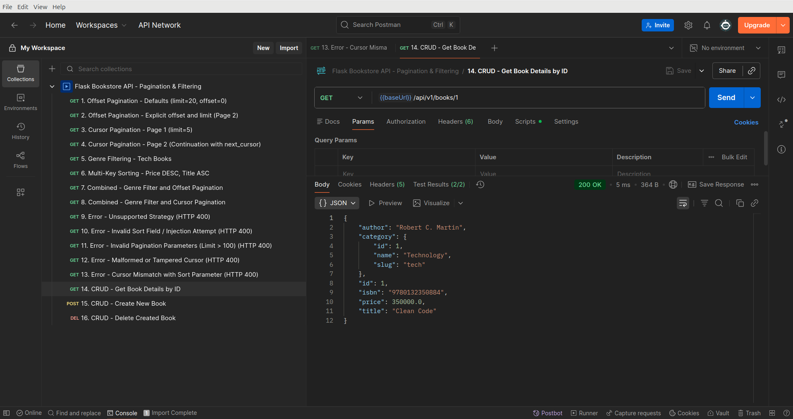

---

### 15. CRUD - Create New Book
- **Request:** `POST {{baseUrl}}/api/v1/books`
- **Body:** JSON thông tin sách mới (`title`, `author`, `isbn`, `price`, `category_id`).
- **Logic:** Tạo mới một cuốn sách vào cơ sở dữ liệu. Dữ liệu đầu vào được validate qua Marshmallow schema, kiểm tra tính tồn tại của `category_id` và tính duy nhất của `isbn`. Trả về `HTTP 201 Created` và lưu lại ID sách mới tạo.

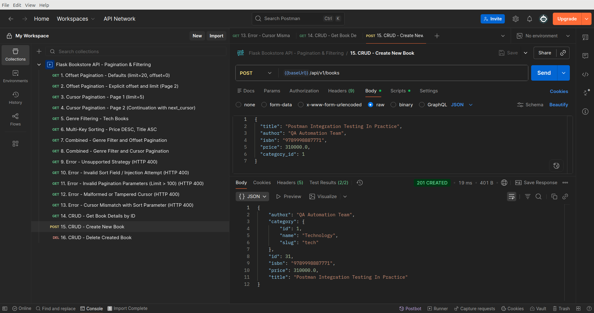

---

### 16. CRUD - Delete Created Book
- **Request:** `DELETE {{baseUrl}}/api/v1/books/{{createdBookId}}`
- **Logic:** Xóa cuốn sách vừa được tạo theo ID để hoàn tất chu trình CRUD và dọn dẹp dữ liệu test. Trả về `HTTP 204 No Content`.

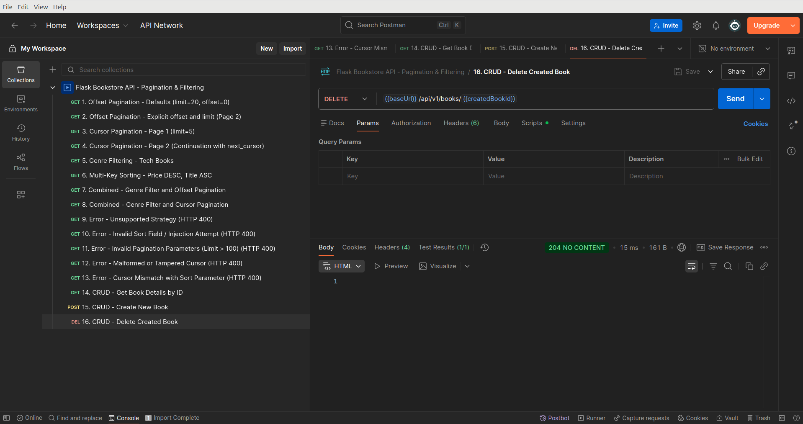

