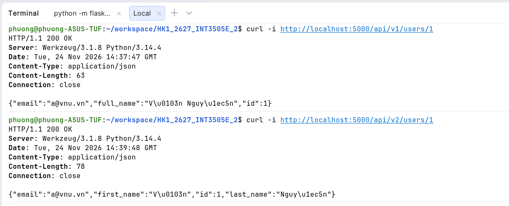
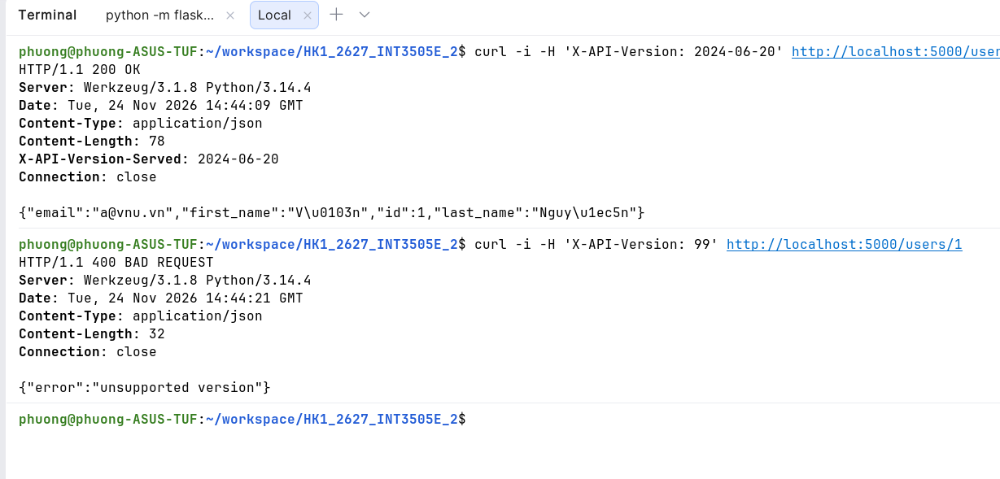
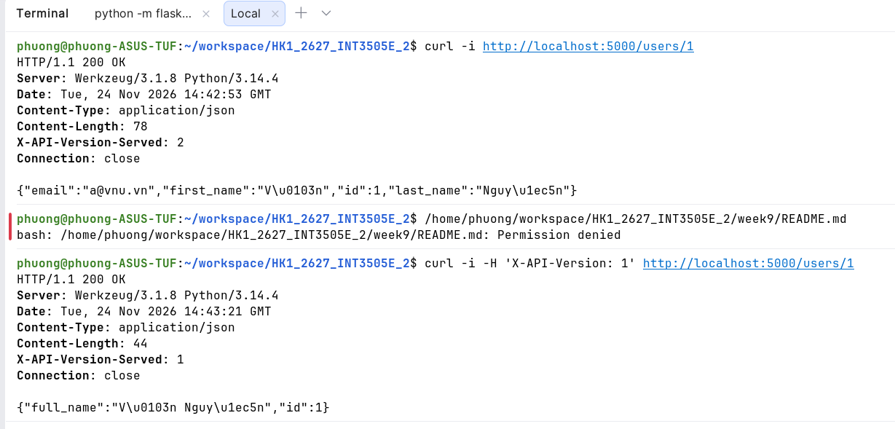
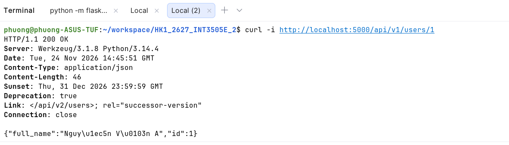
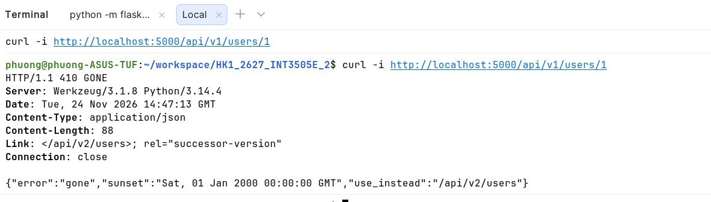
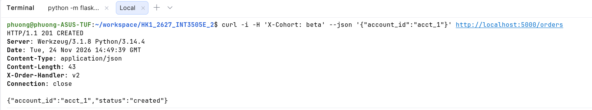
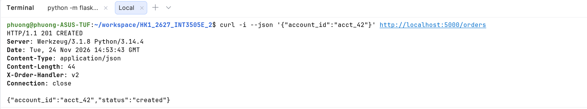
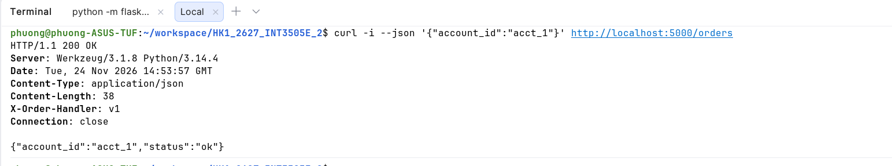
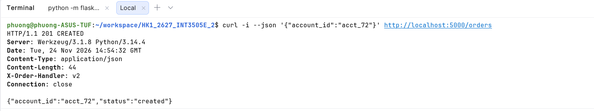

# Week 9 - API Versioning

```bash
python -m pip install -r requirements.txt
```

## lab 1 - URI Path Versioning

```bash
python -m flask --app lab1/app.py run
```

```bash
curl -i http://localhost:5000/api/v1/users/1  # 200, full_name và email
curl -i http://localhost:5000/api/v2/users/1  # 200, first_name, last_name và email
curl -i http://localhost:5000/api/v2/users/99 # 404
```



## lab 2 - Header Versioning

```bash
python -m flask --app lab2/app.py run
```

```bash
curl -i http://localhost:5000/users/1
curl -i -H 'X-API-Version: 1' http://localhost:5000/users/1
curl -i -H 'X-API-Version: 2' http://localhost:5000/users/1
curl -i -H 'X-API-Version: 2024-06-20' http://localhost:5000/users/1
curl -i -H 'X-API-Version: 99' http://localhost:5000/users/1
```

Mặc định phục vụ v2. `X-API-Version-Served` cho biết phiên bản đã chọn. Bản `1` trả `full_name`. Bản `2` và bản theo ngày trả `first_name`, `last_name`, `email`. Phiên bản `99` trả `400`.





## lab 3 - Sunset Middleware

```bash
python -m flask --app lab3/app.py run
```

```bash
curl -i http://localhost:5000/api/v1/users/1
```

Trước `Thu, 31 Dec 2026 23:59:59 GMT`, request trả `200` với `Sunset`, `Deprecation: true` và `Link: </api/v2/users>; rel="successor-version"`. Server ghi warning `deprecated_call` cho mỗi request đến route v1.



Để thử trước hoặc sau sunset vào bất kỳ lúc nào, khởi động lại app với `V1_SUNSET` ở tương lai hoặc quá khứ theo ISO 8601 có múi giờ, rồi gửi lại lệnh `curl`. Ví dụ sau trả `410 Gone` kèm `sunset` và `use_instead` trong JSON.

```bash
V1_SUNSET='2000-01-01T00:00:00+00:00' python -m flask --app lab3/app.py run
```



## lab 4 - Blue-Green Routing

```bash
python -m flask --app lab4/app.py run  # V2_PERCENT mặc định là 5
```

```bash
# Cohort beta → v2
curl -i -H 'X-Cohort: beta' --json '{"account_id":"acct_1"}' http://localhost:5000/orders
# Allow-list → v2
curl -i --json '{"account_id":"acct_42"}' http://localhost:5000/orders
# Bucket 53 → v1, bucket 3 → v2
curl -i --json '{"account_id":"acct_1"}' http://localhost:5000/orders

```





Xem `X-Order-Handler` để biết request đi vào handler nào. v1 trả `200`, v2 trả `201`.
